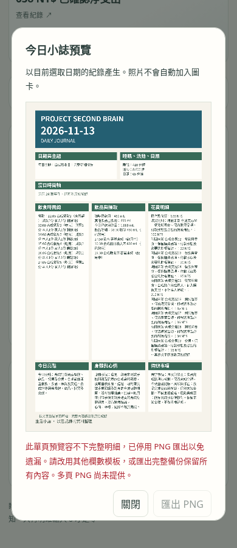
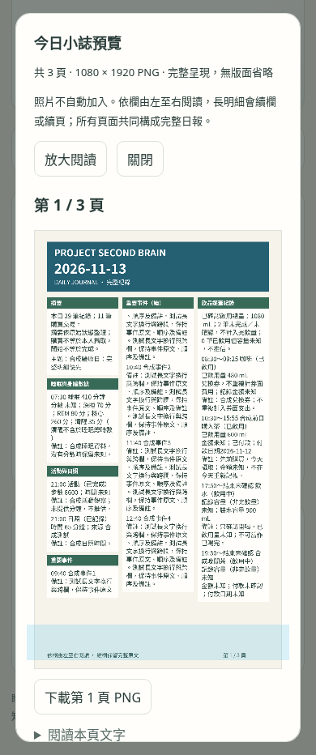

# 三欄小誌排版修復與驗收

修復基準：`main` 的 `5ec3112`。本分支只修改小誌輸出與其測試；沒有合併 main、發布網站、修改私人同步設定、改寫紀錄或統計公式。

## 已整合功能與分支檢查

- `feat/ai-private-data-bridge-20261112` 的 `08100ae` 已由 PR #22 整合進 main。
- Statistics V2（`b2305e7`）、觸控明細（`197dd32`）、v0.5 匯入／備份（`2d87d1e`）均為 main 祖先。
- 舊小誌分支 `fix/20261028-magazine-layout` 有 5 個未以相同 SHA 合併的提交；其測量排版已透過 main 的 `f850d27`／v0.5 路線整合。該舊分支落後 main，不能整支覆蓋目前功能。
- 保留 v8 JSON 格式、付款日期、交易種類、飲用狀態與現有日／週／月統計。

## 原因與修復

| 問題 | 已確認原因 | 修復後 |
| --- | --- | --- |
| 長文字很小 | 固定單頁依序縮到 19px，`fillText(maxWidth)` 還會壓縮字形 | 正文固定 27px、行高 36px；先用同字體測量，無最大寬度壓縮 |
| 狹欄擁擠、旁邊空白 | 每排以最高卡片統一高度，花費不能續欄 | 依閱讀順序逐欄流動，長明細可續欄／續頁，標示「續」 |
| 「另有 N 筆事件」 | 容量不足時逐筆刪減時間軸，N 是版面省略數，並非重複紀錄 | 不再省略；飲食與飲品保留完整起訖時間，重要事件獨立完整列出 |
| 備註、睡眠階段不完整 | 舊文字投影只列部分欄位，並非資料損壞 | 睡眠階段／分數／分段、逐筆備註、付款日期、家人份量及狀態納入輸出 |
| 不能完整下載 | main 發現省略就停用 PNG | 連續多頁預覽，每頁 1080 × 1920，頁碼／總頁數、逐頁 PNG 下載 |

「時間軸」模板槽位現在呈現重要事件；餐點、飲品的起訖時間在各自逐筆區塊呈現一次，不再額外重放成時間軸事件。原始主畫面的互動時間軸未改動。自訂模板的槽位順序、單／雙／三欄、色彩與字體選擇保留。

預覽提供放大至原始 1080px 後橫向捲動，以及可展開的 16px 文字版。多頁 canvas 進入視野才繪製，關閉預覽釋放畫布。每次產生小誌使用穩定的唯讀快照，下載期間不更改來源。

## 合成帳務驗收

[可匯入的合成資料](journal-flow-evidence/synthetic-import.json) 含 29 筆紀錄；品項、時間、睡眠、活動、敘事均重新編寫，只有驗收要求的帳務金額結構保留。沒有把使用者的私人 JSON、真實品項／路線或個人生活備註提交 GitHub。

| 合成分類 | 逐筆金額（NT$） | 小計 |
| --- | --- | ---: |
| 餐飲與零食（交易 01–05） | 100、22、30、95、210 | 457 |
| 合成超市（交易 06–08） | 45、36、34 | 115 |
| 交通（交易 09–11） | 15、22、29 | 66 |
| 11 筆已確認購買支出 | | **638** |

分類僅作合成驗收核對；引擎不從私人自由文字猜測商店分類、不新增資料欄位、不改合計公式。每筆交易都有編號、金額與完整備註。家人份量備註保留；未完成飲品不列入完飲量；合成已確認攝取 1080 mL、2 筆未完成。先前購買的茶不在當日重新記帳，null 不轉成 0。退費與回補另列，測試另確認 638 − 20 − 10 = 608。

## 檔案

| 檔案 | 修改 |
| --- | --- |
| `src/journal-layout.js` | 實際字寬換行、固定字級、可稽核的逐行 ID／位置、跨欄分頁與繪製 |
| `src/journal-document.js` | 唯讀完整日報投影；摘要、睡眠、飲品、飲食、活動日照、花費、事件、風險修正、睡眠因素、總評 |
| `src/journal.js` | 舊與模板匯出入口共同使用新引擎；既有主畫面時間軸／摘要 API 保留 |
| `src/main.js`、`src/style.css` | 多頁預覽、按需畫布、放大／文字閱讀、逐頁下載及錯誤狀態 |
| `tests/journal-layout.test.js` | 逐行恰好一次、頁界、長內容、金額、狀態、匯入、欄數相容性 |
| `tests/journal-flow-browser.cjs`、`tests/fixtures/journal-flow.js` | production 手機瀏覽器驗收、合成資料與下載／繪圖稽核 |
| `package.json` | `test:journal`；加入既有 `test:browser` 與 CI 路徑 |

## 驗證方式與結果

- 單元測試：21 個檔案、147 個測試通過，含 180 事件與超長敘事跨多頁、單／雙／三欄及自訂順序。
- ESLint 與 production build 通過。
- 完整 `npm run test:browser` 通過：原有 CRUD、v0.3／v0.4／v0.5 模板備份、OCR、私人同步、統計觸控、AI 分享，以及新增小誌套件。
- Chromium 153，390px / 430px、touch / mobile 模擬：3 頁 PNG 均成功下載，尺寸都是 1080 × 1920，檔名含頁序與總頁數。
- 使用瀏覽器實際字體測量，檢查每一行 ID／索引僅出現一次；比對實際 UI 畫布繪製文字與座標，確認下載頁面內容一致，不使用 PNG 壓縮位元組作字體渲染判斷。
- 11 筆交易／638、完整狀態與備註、放大／文字閱讀、重複匯入不新增、匯入前後欄位一致、匯出前後 localStorage 不變、無對外資料請求或頁面錯誤。
- 稀疏合成資料三欄輸出為單頁；同時驗證單欄、雙欄模板可預覽與下載。
- 使用 production preview 驗收；開發模式的 Vite inline CSS 被既有 CSP 阻擋，不拿無樣式的開發頁作手機樣式證據。

[單元紀錄](journal-flow-evidence/unit-tests.txt) · [lint](journal-flow-evidence/lint.txt) · [build](journal-flow-evidence/build.txt) · [小誌瀏覽器紀錄](journal-flow-evidence/journal-browser.txt) · [完整瀏覽器回歸紀錄](journal-flow-evidence/all-browser.txt)

## 截圖與匯出

同一合成資料在 main 與本分支各自 production build 後比較。

| 修復前：390px | 修復後：390px |
| --- | --- |
|  |  |

[430px 前](screenshots/journal-flow/before-430.png) · [430px 後](screenshots/journal-flow/after-430.png) · [放大閱讀](screenshots/journal-flow/zoom-390.png)

[修復前不完整單頁](screenshots/journal-flow/before-page.png) · [修復後單頁範例](screenshots/journal-flow/single-3-column.png) · [多頁 1/3](screenshots/journal-flow/multi-page-1.png) · [多頁 2/3](screenshots/journal-flow/multi-page-2.png) · [多頁 3/3](screenshots/journal-flow/multi-page-3.png)

## 限制

- **未完成真正的 iPhone Safari 實機驗證。** Chromium 手機尺寸／觸控模擬不等於 Safari；未聲稱 WebKit 或 iOS 分享／相簿存檔已驗證。
- 三欄全頁縮到手機寬度時仍須放大閱讀；不以縮小正文字級換取單頁。不同裝置的中文字體可能造成頁數／換行不同，所有頁面在同一次產生時使用同一計畫。
- 保留原文與明細，未生成新的健康建議。風險修正以原有 todo／備註呈現，睡眠因素只列已記錄時段與狀態，不保證睡眠結果。
- 尚未套用使用者真實資料到正式網站；驗收採合成紀錄。圖片不含原照片，私人同步及資料結構未變更。
